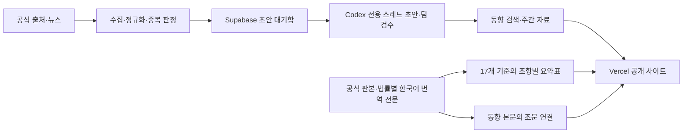

# 국제요정

글로벌 개인정보 보호 동향을 수집·검색하고, 한국어로 해외법제를 읽고 비교하는 플랫폼입니다. 수집 자료에 나오는 법 조항과 법제 DB를 연결하여 소식에서 근거 조문까지 이어서 확인할 수 있도록 기획하고 있습니다.

> **현재 상태(2026-10-26):** 공개 사이트는 `/public`, 팀 작업실은 `/team?role=trends|legal`입니다. 동향 작업실은 사이트 팀 로그인으로 DB 원고를 확인하고 Codex 연결키로 비공개 수정본을 저장합니다. 법제 작업실은 기존 담당 브랜치에서 비교표와 전체 번역을 읽습니다. 각 담당자는 자료를 훑어본 뒤 Codex에 자연어로 한 번에 수정 요청을 할 수 있습니다. 현재 자료 수와 권한·배포 주의는 [담당자 작업실 안내](./docs/live-team-workspace.md)를 확인해 주세요.

### 로컬에서 검토하기

담당자 최신 작업은 `/team?role=trends`(동향), `/team?role=legal`(법제)에서 확인합니다. 동향은 팀 로그인으로 DB 초안 전체를 읽고, 법제는 17개 기준 비교표와 전체 번역을 읽습니다. 화면의 **Codex 연결 프롬프트 복사**로 자연어 수정 요청을 보냅니다. 동향 연결키는 별도 만료 없이 유지되며 새 키 발급 또는 연결 해제로 폐기됩니다. 계정 비밀번호·DB 관리자 키를 공유하지 않습니다. DB 동향 수정본은 비공개 작업실에 저장하고, 법제·GitHub 자료는 기존 담당 브랜치에 push합니다. 병합·자료별 재배포 없이 자동 갱신합니다. [사용 방법과 실패 확인](./docs/live-team-workspace.md)

```bash
pnpm install --frozen-lockfile
pnpm dev
```

브라우저에서 `http://localhost:3000`을 열면 담당자 작업실로 이동합니다. 공개 화면은 `/public`입니다. 팀 계정이 설정된 로컬 환경에서는 동향 초안을 불러옵니다. Vercel Preview는 배포된 브랜치의 자료를 읽습니다.

`http://localhost:3000/team`은 담당자 작업실입니다. 공개 저장소의 법제 자료는 읽을 수 있고, DB 동향 초안은 팀 로그인 또는 만료되는 읽기 연결키로 보호합니다. 항목별 의견 입력 대신 Codex에 수정 요청을 전달합니다. 기존 피드백 기록은 유지합니다. `/work`와 `/work/legal`의 DB 저장·승인·발행 권한은 별개이며 Preview의 운영 쓰기 제한은 유지합니다.

## 문서

| 문서 | 용도 |
| --- | --- |
| [architecture.md](./architecture.md) | 제품 범위, 수집·검색 파이프라인, 법제 비교 UX, 데이터 모델, 권한, 배포, 개발 단계 |
| [README.md](./README.md) | 프로젝트 소개, 현재 상태, 팀 참여 및 재현 가능한 개발 환경의 준비 기준 |
| [docs/team-onboarding.md](./docs/team-onboarding.md) | 비개발자 팀원을 위한 역할, Codex 사용법, GitHub·PR 작업 순서 |
| [docs/collector-ingest-contract.md](./docs/collector-ingest-contract.md) | 수집기가 자료·판본·초안 작업을 중복 없이 DB에 넣는 규칙 |
| [docs/editorial-publication.md](./docs/editorial-publication.md) | 팀 작업 공간에서 동향·법제 수정, 선택 일괄 공개, 공개 취소·복원 |

문서 기준일은 2026-10-26입니다. 통합 범위·현재 경로·DB 반영 순서는 [통합 안내](./docs/integration/README.md), 전체 요구사항은 architecture.md, 팀 작업 절차는 docs/team-onboarding.md를 기준으로 합니다. 과거 날짜가 붙은 구현 기록은 당시의 검증 범위입니다.

### 역할을 읽는 방법

문서의 `프로젝트 리드`, `법제 담당`, `동향 담당`은 고정된 역할명입니다. 문서를 읽거나 Codex와 대화하는 사람이 자동으로 프로젝트 리드가 되지는 않습니다. 작업을 시작할 때 자신의 역할을 먼저 밝히고, 역할이 명시되지 않았다면 Codex는 문서만 보고 추정하지 않고 확인해야 합니다.

## 제공하려는 기능

1. **글로벌 동향 수집과 주간 자료**: 감독기구·국제기구·판례·주요 매체의 자료를 수집합니다. 같은 Codex 프로젝트의 전용 스레드가 지정 양식의 한국어 초안을 만들고 Supabase에 반환하며, 팀 검수 후 발행합니다.
2. **동향 검색**: 키워드와 의미 검색을 함께 사용하고 관련도·원문 게시일·국가·주제·출처로 탐색합니다.
3. **해외법제 열람과 비교**: 해외법마다 전체 조문을 읽을 수 있는 한국어 번역 전문을 만들고, 한국법은 공식 한국어 전문을 기준으로 삼습니다. 첫 범위는 한국 개인정보 보호법, 일본 APPI, 중국 PIPL, EU GDPR, 영국 UK GDPR, 미국 캘리포니아 CCPA, 싱가포르 PDPA입니다. 각 전문을 완성한 뒤 17개 기준에 따라 조항을 분류한 요약표에서 근거 조문을 바로 확인합니다.
4. **조문 연결**: 동향 본문에서 언급한 법 조항의 정확한 버전으로 이동하고, 호버·클릭·키보드·모바일 탭으로 조문을 미리 봅니다.

**공개 범위는 확정되었습니다.** 공개 발행 자료는 누구나 볼 수 있습니다. `/team`의 동향 DB 원고와 비공개 수정 제안은 로그인한 팀원만 볼 수 있고, 법제 작업실은 담당 브랜치에 제출된 자료를 보여줍니다. 첫 법제 범위는 한국 개인정보 보호법, 일본 APPI, 중국 PIPL, EU GDPR, 영국 UK GDPR, 미국 캘리포니아 CCPA, 싱가포르 PDPA입니다. 초기 동향 수집은 EDPB·OECD·CJEU(CURIA)부터 시작합니다.

## 기술 구성 제안

| 영역 | 선택안 |
| --- | --- |
| 개발·협업 | Codex, 공개 GitHub 저장소, Pull Request 리뷰 |
| 웹·API·배포 | Next.js, TypeScript, Vercel |
| 데이터·인증·파일 | Supabase Postgres, Auth, Storage |
| 검색 | Postgres 어휘 검색 + pgvector 의미 검색 |
| 정기 수집 | Supabase Cron → Queues → 짧은 Edge Functions 작업 |
| 가공·번역 | 같은 프로젝트의 Codex 전용 스레드·Automation + 사람 검수 |
| 긴 문서·OCR·브라우저 | 필요가 확인되면 별도 컨테이너 워커 추가 |



초안 생성에는 별도 생성형 AI API를 사용하지 않습니다. 같은 Codex 프로젝트에 전용 작업 스레드를 두고 Automation으로 정기 실행합니다. 수집기는 Supabase에 대기 작업을 쌓고, Codex 스레드가 이를 가져와 구조화된 초안과 근거를 다시 저장합니다. 사이트가 Codex 스레드를 실시간 호출하지는 않습니다.

수집과 공개 사이트는 Codex가 꺼져 있어도 계속 작동합니다. 다만 Codex 앱 또는 자동화 실행 환경이 멈추거나 구독 사용 한도에 도달하면 초안 생성은 대기합니다. 이 방식은 OpenAI API 별도 과금을 피하지만 Codex 구독 사용량과 Supabase·Vercel 사용량은 소비합니다. [Codex의 병렬 스레드와 Automations](https://developers.openai.com/blog/run-long-horizon-tasks-with-codex)

## 설계에서 지키는 원칙

- 공식 API·RSS를 우선 사용하고, 필요한 출처에만 HTML·PDF 수집을 추가합니다.
- AI 요약·번역·비교 결과는 근거와 검수 상태를 갖습니다. 원문에 없는 내용을 사실로 채우지 않습니다.
- 해외법의 한국어 번역은 법률별 전문 문서로 조문 순서를 보존합니다. 원문과 누락을 대조한 뒤 그 조항을 17개 기준표에 연결합니다.
- 원문 게시일, 사건일, 수집일, 사이트 공개일을 구분합니다.
- 법령 개정 전후 버전과 번역 버전을 보존합니다. 오래된 동향의 인용을 현재 조문으로 조용히 바꾸지 않습니다.
- 비교표의 미검토·자료 없음·직접 규정 미발견을 구분합니다.
- 검색·집계·조문 팝업·다운로드에도 동일한 공개 권한을 적용합니다.
- 실패한 수집 작업은 기록하고 재처리합니다. 같은 자료를 반복 수집해도 발행 항목이 중복되지 않게 합니다.
- 공개 소스코드와 외부 원문·운영 데이터의 공개 범위를 분리합니다.

## 팀원이 지금 참여하는 방법

1. 담당자는 화면의 역할별 안내와 Codex 프롬프트를 엽니다.
2. 자신의 Codex가 `parksunup/globaltrend` 저장소와 기존 작업 브랜치(`feat/legal-corpus-foundation` 또는 `feat/trend-source-contracts`)에 연결되어 있는지 확인합니다. 새 브랜치를 만들지 않습니다.
3. 동향 담당은 팀 계정으로 작업실에 로그인해 원고 전체를 읽고 자연어로 수정 요청을 합니다. 법제 담당은 비교표와 법률별 전체 번역을 읽고 기존 브랜치의 자료를 수정합니다.
4. 수정 전후 내용을 화면에서 확인하고, 안내된 검증을 거친 뒤 기존 작업실 저장 또는 담당 브랜치에 반영합니다. 공개 발행이나 PR 병합은 별도 절차입니다.

조사 자료의 구조와 저장 위치는 [data/README.md](./data/README.md)에서 확인할 수 있습니다. 담당자는 다른 역할의 브랜치나 폴더를 수정하지 않습니다. 작업실 프롬프트에는 저장소 확인, 기존 브랜치 사용, 허용된 파일 범위, 검사와 결과 공유 절차가 포함되어 있습니다.

코드 변경은 GitHub Pull Request로 관리합니다. 작업실 동향 원고 수정 제안은 비공개 작업실 테이블에 저장되며 GitHub PR이나 공개 발행과는 별개입니다. 법제 자료는 담당 브랜치에 저장하고 PR Preview에서 확인할 수 있습니다. CI가 실행되더라도 실제 Vercel 배포 상태와 DB 적용 여부는 각 화면에서 별도로 확인해야 합니다.

작업실 코드는 기존 PR의 Vercel Preview에서 먼저 확인할 수 있습니다. Preview 작업실은 동향 DB 원고를 팀 로그인으로 읽으며, 수정본은 비공개 작업실 테이블에 저장합니다. 법제 자료는 기존 담당 Git 브랜치에서 읽습니다. 이 화면에 저장된 수정이 대외 발행된 것은 아닙니다.

담당자 작업실은 자료를 역할별로 바로 읽습니다. 동향은 로그인한 뒤 DB 한국어 원고 전체를 살펴보고 자연어 수정 요청을 Codex에 전달합니다. 법제는 17개 기준 비교표와 법률별 전문을 각각 확인합니다. 항목별 의견을 일일이 남기는 흐름은 선택 사항입니다. 기존 피드백 데이터와 공개 조회 경로는 보존합니다. 새 업무 흐름, 연결키 보호, 자료 저장 범위는 [담당자 작업실 안내](./docs/live-team-workspace.md)를 따릅니다.

법제 범위는 **한국 개인정보 보호법, 일본 APPI, 중국 PIPL, EU GDPR, 영국 UK GDPR, 미국 캘리포니아 CCPA, 싱가포르 PDPA**로 확정되었습니다. 영국은 UK GDPR과 Data Protection Act 2018 등 보완 법령을 연결해 관리합니다. 비교 기준은 한국·일본 비교표의 17개 행을 기본으로 사용합니다. 현행 조문과 판본은 별도로 검증합니다. 주간 자료는 팀원이 작업 브랜치에 추가한 기준 자료의 표지·목차·항목 본문 구조를 웹 템플릿의 기준으로 삼습니다.

번역 전문의 GitHub 공개 가능 여부는 원문·번역의 이용조건에 따라 판단합니다. 현재 법제 작업실은 공개 저장소에 제출된 전문을 표시합니다. 새로 공개 저장소에 넣는 자료의 재배포 가능 여부와 이미 제출한 초안의 작업실 열람은 구분합니다.

## 목표로 하는 로컬 개발 환경 기준

이 절은 팀원이 새 컴퓨터에서 작업을 재현할 때 필요한 기준입니다. 현재 앱의 실행과 환경 설정은 위의 로컬 검토 절을 먼저 따르고, 이 절의 나머지 항목은 기능을 확장할 때 확인합니다.

### 준비 도구

- Git, 프로젝트가 고정한 Node.js 버전과 패키지 매니저.
- 로컬 Supabase를 사용하는 경우 지원되는 컨테이너 런타임과 고정된 Supabase CLI 버전.
- Edge Functions 개발·검증에 필요한 Deno 환경. Next.js의 Node 환경과 혼동하지 않도록 안내합니다.
- 로컬 합성 seed와 고정된 Codex 결과 fixture. Codex를 실제로 실행하지 않아도 화면·권한·DB·검색의 핵심 테스트를 실행할 수 있어야 합니다.

구현 시 런타임 버전, 패키지 매니저, 의존성 잠금 파일, Supabase 설정을 저장소에 고정합니다. 운영 DB 접근 없이도 기여할 수 있는 것이 완료 조건입니다.

### 새 개발자에게 제공할 순서

1. 저장소를 clone합니다.
2. 저장소에 고정한 도구 버전으로 의존성을 설치합니다.
3. `.env.example`을 복사하고 로컬 개발 값만 입력합니다.
4. 로컬 Supabase를 시작하고 migration과 합성 seed를 적용합니다.
5. 웹 및 로컬 Edge Functions를 실행합니다. 실제 외부 수집 스케줄은 비활성 상태로 시작합니다.
6. 예제 동향 검색 → 팀 계정 검수 → 예제 주간호 발행 → 예제 조문 확인 흐름을 실행합니다.
7. 관련 검증을 통과시킨 뒤 작업 브랜치에서 PR을 만듭니다.

현재는 웹 실행 명령, 패키지 잠금 파일, `.env.example`, Supabase 초기 migration과 seed, 팀 조사 자료 자동 검증과 GitHub Actions가 있습니다. 로컬 Supabase migration 재생과 RLS 검사는 아래 명령과 CI에서 자동화합니다. 합성 데이터로 실행하는 전체 제품 흐름과 Edge Functions는 아직 없습니다.

### 로컬 Supabase 실행과 검사

Docker Desktop을 먼저 설치하고 실행합니다. 저장소가 고정한 CLI는 `pnpm install` 때 함께 설치되므로 별도 전역 설치는 필요하지 않습니다.

```bash
pnpm supabase:start
pnpm supabase:verify
pnpm supabase:stop
```

- `supabase:start`: 로컬 Supabase와 Studio를 시작합니다. 같은 컴퓨터에서는 이전 로컬 데이터를 이어서 사용하고, 새 환경에서는 migration·개발 seed로 DB를 재현합니다.
- `supabase:verify`: 검사용 로컬 DB를 비운 뒤 migration·seed를 처음부터 다시 적용하고 `supabase/tests/`의 pgTAP 검사를 실행합니다. **로컬 DB의 데이터는 삭제되므로 보존할 로컬 작업이 있을 때는 실행하지 않으며, 운영 프로젝트에 연결해서도 실행하지 않습니다.**
- `supabase:stop`: 로컬 데이터를 보존한 채 컨테이너를 종료합니다. 다음 `supabase:start`에서 이어서 사용합니다.

운영·Preview Supabase는 로컬 Docker DB와 별개입니다. 컴퓨터를 바꾸거나 로컬 Docker 데이터가 사라져도 운영 DB를 다시 만드는 것이 아니라, 새 로컬 DB만 Git에 저장된 migration과 개발 seed로 재현합니다. 실제 조사 결과와 운영 데이터는 migration이나 공개 저장소의 seed에 넣지 않습니다.

검사는 초기 출처 3곳, 법제 7개, 비교 기준 17개가 재현되는지 확인합니다. 또한 비로그인 사용자는 미공개 법제·기준을 읽을 수 없고, reviewer는 읽기만, editor는 수정할 수 있는지 검사합니다. GitHub Actions도 PR마다 같은 migration 재생과 RLS 검사를 실행하며 운영 Supabase 비밀값은 사용하지 않습니다.

### 환경변수 계약안

이름은 구현 시 확정하며 아래에는 실제 값을 적지 않습니다.

| 예시 이름 | 위치 | 용도 |
| --- | --- | --- |
| `NEXT_PUBLIC_SUPABASE_URL` | 웹 공개 설정 | 해당 환경의 Supabase 주소 |
| `NEXT_PUBLIC_SUPABASE_PUBLISHABLE_KEY` | 웹 공개 설정 | RLS가 적용되는 공개 클라이언트 키 |
| `SUPABASE_SECRET_KEY` | 필요한 서버/워커에만 | 권한 있는 내부 작업. 일반 공개 조회에 사용하지 않음 |
| `CODEX_DRAFT_WORKER_TOKEN` | Codex 로컬 작업 환경 | 초안 claim·submit·fail 전용 RPC 인증. 브라우저·Vercel 클라이언트에 노출 금지 |
| `CODEX_DRAFT_BATCH_SIZE` | Codex 작업 환경 | 자동화 한 번에 처리할 최대 문서 수 |
| `EMBEDDING_MODEL` | 검색 워커/서버 | 한국어·다국어 의미 검색 모델 설정 |
| `WORKER_TRIGGER_SECRET` | Supabase 수집 워커 | 수집·추출 소비자 호출 검증 |
| `DATABASE_URL` | 로컬/승인된 migration 작업 | 스키마 작업에 필요한 연결 |
| `COLLECTION_ENABLED` | 워커 | 로컬·Preview에서 실제 수집 차단 |
| `SITE_URL` | 웹 서버 | 절대 링크·인증 리디렉션 기준 |

호스팅 Edge Functions의 예약 환경변수와 키 주입 방식은 구현 시 공식 문서로 확인합니다. `.env.example`에는 이름·설명만 넣고, `.env*` 실제 파일·운영 덤프·토큰·`.vercel` 연결 정보는 커밋 대상에서 제외합니다. 공개 가능한 설정과 서버 비밀값의 구분은 필수입니다.

## 현재 저장소 구조와 예정 영역

현재 저장소에는 Next.js 검토 화면과 Supabase 초기 migration이 있습니다. 아래에서 `(예정)`으로 표시한 영역은 아직 만들지 않았습니다.

```text
/
├── README.md
├── architecture.md
├── app/                        # Next.js 공개·팀 검토 화면과 웹 온보딩 안내
├── lib/supabase/               # 브라우저·서버 Supabase 클라이언트
├── middleware.ts               # Supabase Auth 세션 갱신
├── packages/                   # (예정) 공용 계약·수집·검색·템플릿
│   ├── contracts/              # 데이터·작업 payload 스키마
│   ├── ingestion/              # 출처 어댑터·정규화
│   ├── processing/             # 정규화·규칙 필터·초안 작업 계약
│   ├── search/                 # 검색 계약·평가 도구
│   └── templates/              # 보고서 렌더링
├── supabase/
│   ├── migrations/             # 현재 초기 테이블·RLS·seed
│   ├── functions/              # (예정) 짧은 큐 소비자
│   └── tests/                  # (예정) 데이터·권한 검증
├── tests/                      # (예정) 회귀·검색·브라우저 검증
│   ├── fixtures/               # 재배포 가능한 추출 표본
│   ├── search-evaluation/      # 한국어 질의·관련성 평가
│   └── e2e/                   # 핵심 사용자 흐름
├── docs/                       # 팀 온보딩·설계 검토·작업 계획
├── .agents/skills/             # (예정) Codex 초안 생성·검수 작업 지침
├── .github/                    # 현재 Issue·PR 양식과 기본 CI, 소유자 설정은 예정
├── .env.example                # 환경변수 이름과 설명
└── LICENSE                     # (예정) 소유자가 라이선스 선택 후 추가
```

순수 TypeScript 데이터 계약은 Node/Deno 양쪽에서 재사용하되 런타임 전용 코드를 분리합니다. Supabase 함수 배포에 필요한 공유 모듈 포함 경로도 자동 검증합니다. 처음에는 실제로 필요한 패키지만 생성합니다.

## 기여와 검증

짧은 작업 브랜치에서 수정하고 PR에 문제·변경 결과·검증 결과를 적습니다. `main` 직접 변경보다 리뷰를 거치는 방식을 기본으로 합니다. 출처 파서 변경에는 재배포 가능한 회귀 표본을, 검색 변경에는 같은 질의셋의 전후 비교를, 권한 변경에는 허용·거부 검증을 포함합니다.

첫 구현 이후 CI가 확인해야 할 항목은 다음과 같습니다.

- lint·타입·웹 빌드와 변경한 기능의 테스트.
- 빈 로컬 DB에 migration을 처음부터 적용할 수 있는지 여부.
- 비로그인·비팀원·팀 역할별 자료 접근과 파일·검색 권한.
- 중복 실행·중단 후 재처리, 주간 경계, 판본을 고정한 조문 연결.
- 검색·주간호·비교표의 핵심 브라우저 흐름과 모바일·키보드 사용.

외부 fork PR에는 DB·Codex 워커·배포 비밀키를 제공하지 않습니다. 코드 검증에 실제 운영 기사·사용자 자료나 실제 Codex 실행이 필요하지 않도록 합성 데이터와 고정 결과를 준비합니다.

## 배포 기준

웹은 Vercel, DB·파일·수집 작업은 Supabase에 배포합니다. 로컬/Preview/운영 데이터를 분리하고, Preview는 운영 DB와 운영 수집기를 사용하지 않습니다.

권장 순서는 **PR 검증 → Preview 확인 → 호환 DB migration → 워커·웹 배포 → 핵심 흐름 확인 → 운영 기능 활성화**입니다. migration과 무관하게 새 웹이 먼저 공개되는 일이 없도록 운영 릴리스 게이트를 둡니다. 구체적인 워크플로 파일과 배포 절차는 첫 배포 PR에서 검증하여 추가합니다. [Vercel GitHub 연동 문서](https://vercel.com/docs/git/vercel-for-github)

공개 GitHub 저장소는 `parksunup/globaltrend`로 운영 중입니다. 운영 Supabase·Vercel 프로젝트, 운영 배포 URL, 정기 수집 설정은 이 문서에 아직 지정되지 않았습니다.

## 개발 단계

| 단계 | 목표 |
| --- | --- |
| P0 | 7개 법제 목록, EDPB·OECD·CJEU 출처, 주간 PDF 구조, 비교 기준, 예산·검수 담당·라이선스 확정 |
| P1 | 재현 가능한 개발 환경과 소규모 수집→Codex 초안→검수→발행 전체 흐름 |
| P2 | 일일 동향 수집, 하이브리드 검색, 주간 자료 운영 |
| P3 | 지정 법제의 판본·법률별 한국어 번역 전문·17개 기준표·동향 조문 연결 |
| P4 | 실제 양식의 파일 출력, 필요한 고급 수집과 추가 법제 |

세부 완료 조건은 [architecture.md](./architecture.md)에 있습니다. 날짜·공수·월 운영비는 실제 자료량과 팀 구성 확인 후 산정합니다.

## 공개 코드와 콘텐츠 이용

코드 라이선스는 **미선정**이며 MIT를 후보로 제안합니다. 소유자 선택 후 LICENSE를 추가합니다. 외부 기사·판례·법령·번역·보고서 데이터는 코드 라이선스에 자동 포함하지 않습니다. 공개 저장소를 만드는 것만으로 소프트웨어 재사용 라이선스가 정해지는 것은 아닙니다. [GitHub 라이선스 안내](https://docs.github.com/en/repositories/managing-your-repositorys-settings-and-features/customizing-your-repository/licensing-a-repository)

외부 자료는 원출처·이용조건·보관·Codex 처리·재배포 범위를 기록합니다. 저장소에는 비밀값, 운영 DB 덤프, 무허가 기사 전문이나 번역 파일을 넣지 않습니다.


## 수집기 구현 기록과 현재 통합 상태

#32의 수집 코드·원문 판본·초안 작업 임대/제출·`/work` 검수 대기함을 포함합니다. 조사 자료 기준은 #16 `c42db8b`이며 모든 출처와 정기 실행 스위치는 비활성입니다. 과거 운영 시험·비용 확인의 범위는 [클라우드 수집 상태 문서](./docs/trend-collector-cloud.md), 현재 실행 준비 조건은 [통합 안내](./docs/integration/README.md)를 확인해 주세요. 코드를 통합했다는 사실이 정기 운영이나 main 병합 완료를 뜻하지 않습니다.

## 동향 보고서 문체 · 2026-10-18

수집된 9출처·21건 전체의 보고서 편집본은 `data/trends/editorial/report-drafts.{json,md}`에 있습니다. 검색·상세·팀 검토·주간 예시호와 기존 초안 가져오기가 같은 편집본을 읽습니다. 원제·공식 URL·날짜·근거·보류 사유는 기존 조사 기록에 보존합니다.

앞으로 모든 동향 작성 시 [보고서 작성 기준](docs/trend-report-style.md)을 먼저 읽습니다. 수집기는 원문을 보존하고 Codex가 한국어 보고서체로 작성합니다. 새 표본 추가 시 보고서 편집본을 함께 추가하고 `node scripts/trend-report.mjs --render`, `npm run validate:data`를 실행합니다. DB 초안 제출 전에는 `node scripts/trend-report.mjs --check <파일>`을 실행합니다. 형식 통과가 사실 검수나 발행을 뜻하지 않습니다.


## 팀 작업 공간

`/work`에서 동향·법제를 함께 검색하고 선택해 공개합니다. 공개 중 자료의 수정은 별도 작업본에 저장하며, 관리자가 수정본 공개를 눌러야 외부 내용이 바뀝니다. 공개 취소와 복구 가능한 휴지통도 같은 목록에서 사용합니다. 세부 사용법은 [자료 관리·공개 안내](./docs/editorial-publication.md)를 참고하세요. `/team` 열람과 `/public` 공개 사이트는 유지합니다.
